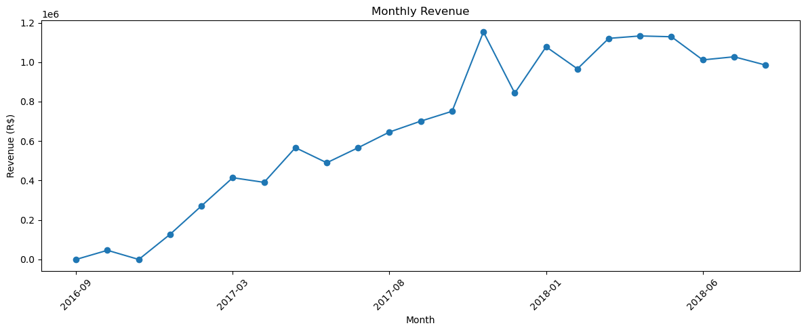
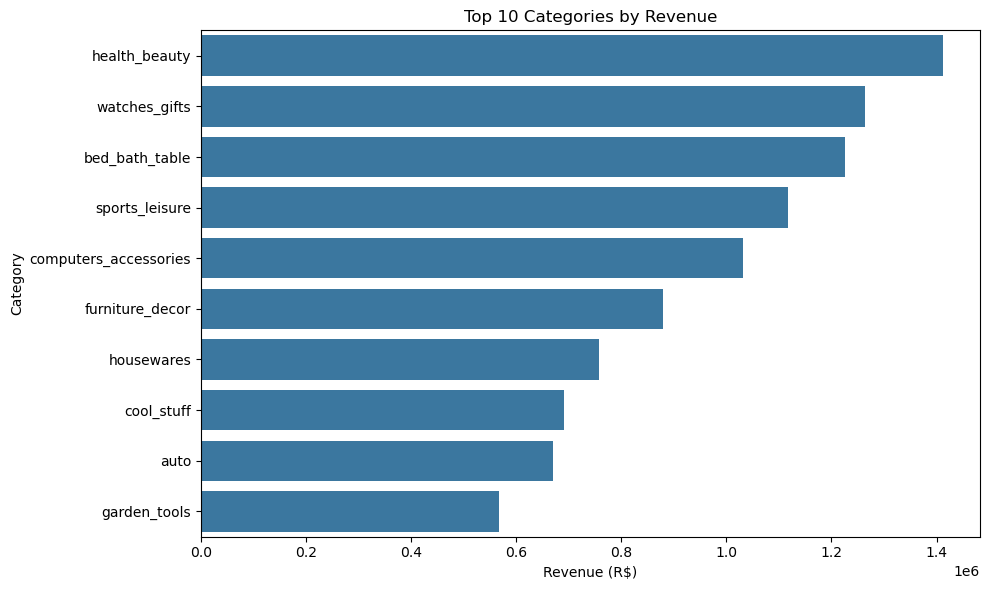
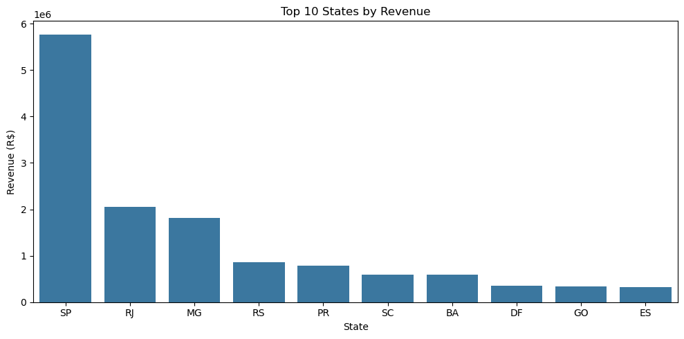
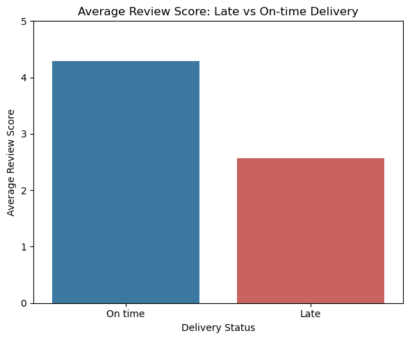

# E-commerce Sales Analytics (Olist, Brazil)

An end-to-end data analysis project on a Brazilian e-commerce marketplace, using **MySQL** for querying, **Python** for cleaning and exploration, and **Power BI** for an interactive dashboard.

## Problem Statement

Where does the revenue come from, which categories and states drive it, and how does late delivery affect customer satisfaction?

## Dataset

[Olist Brazilian E-commerce Public Dataset](https://www.kaggle.com/datasets/olistbr/brazilian-ecommerce) (Kaggle): about 100K orders from 2016 to 2018.
The CSV files are not included in this repository because of their size. Download them from the link above.

## Tools Used

- **MySQL:** joins, CTEs, window functions (`LAG`)
- **Python:** Pandas, Matplotlib, Seaborn, SQLAlchemy
- **Power BI:** KPI cards, trend line, category and state charts, slicers

## Project Structure

```
├── sql/          SQL queries (each with its business question)
├── notebooks/    01_load_data.ipynb, 02_analysis.ipynb
├── powerbi/      Power BI dashboard file
├── images/       Charts and dashboard screenshot
└── README.md
```

## Dashboard


## Key Insights

1. **Revenue:** 96,477 delivered orders generated **R$ 15.4M** in revenue, with an average order value (AOV) of **R$ 159.86**.
2. **Growth:** Monthly revenue grew steadily through 2017, reaching a peak of about R$ 1.15M, and stayed around R$ 1.0-1.1M through 2018.
3. **Categories:** The top 3 categories (`health_beauty`, `watches_gifts`, `bed_bath_table`) together generated about **R$ 3.5M** in item revenue.
4. **Geography:** São Paulo (SP) alone contributes about **37%** of revenue. SP, RJ and MG together account for about 63%.
5. **Delivery:** About **8%** of orders were delivered late. Late orders averaged a review score of **2.57**, compared with **4.29** for on-time orders.
6. **Payments:** Credit cards account for about **78%** of payment revenue.

## Charts

| Monthly Revenue | Top Categories |
|---|---|
|  |  |

| Top States | Delivery vs Reviews |
|---|---|
|  |  |

## Recommendations

- **Reduce late deliveries.** They lower the average review score by about 1.7 points.
- **Reduce dependence on São Paulo** by growing sales in other states such as RS and PR.
- **Promote credit card offers and installment plans**, since most revenue comes through cards.

## Challenges and Fixes

- **Date format:** The CSV dates were in `DD-MM-YYYY HH:MM` format, which broke the default `pd.to_datetime()`. Fixed by passing an explicit `format` and verifying that NULL counts did not change.
- **Special characters in the database password:** Characters like `@` broke the connection string. Fixed by using SQLAlchemy's `URL.create()`.
- **File encoding:** One CSV (customer reviews) contained non-UTF-8 characters. Fixed with a `latin-1` fallback when reading.
- **Data validation:** After loading, row counts and date ranges were checked in MySQL against the source files (for example, 99,441 orders).

## Notes

- The KPI and delivery analyses use delivered orders only. Category, state and payment analyses include all orders.
- The dataset has very few orders in late 2016, so trend conclusions focus on 2017 and 2018.

## How to Run

1. Download the dataset from Kaggle and place the CSV files in a `data/` folder.
2. Create a MySQL database named `olist`.
3. Run `notebooks/01_load_data.ipynb` (it asks for your MySQL password at runtime).
4. Run the queries in `sql/` in MySQL Workbench.
5. Run `notebooks/02_analysis.ipynb` for the charts.

## Author

**Sneha Yadav** | [LinkedIn](https://www.linkedin.com/in/snehayadav797)

.
